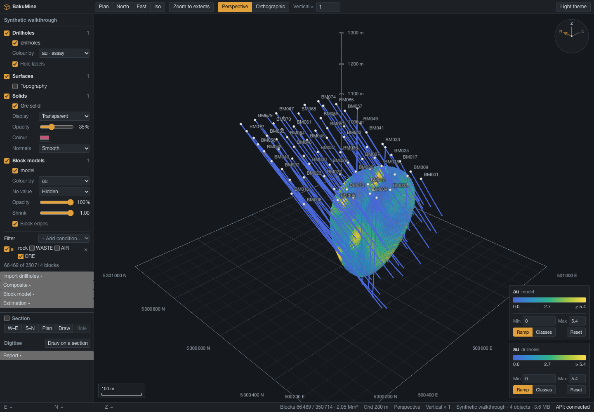
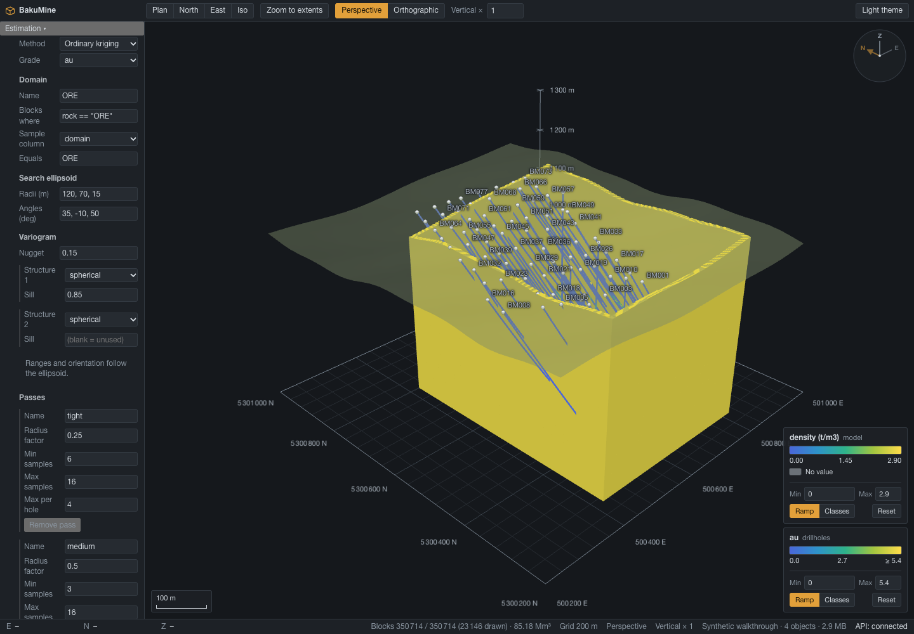
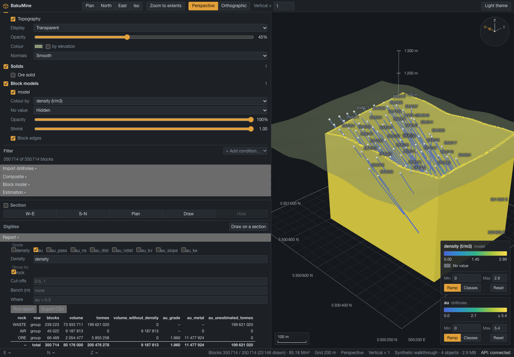
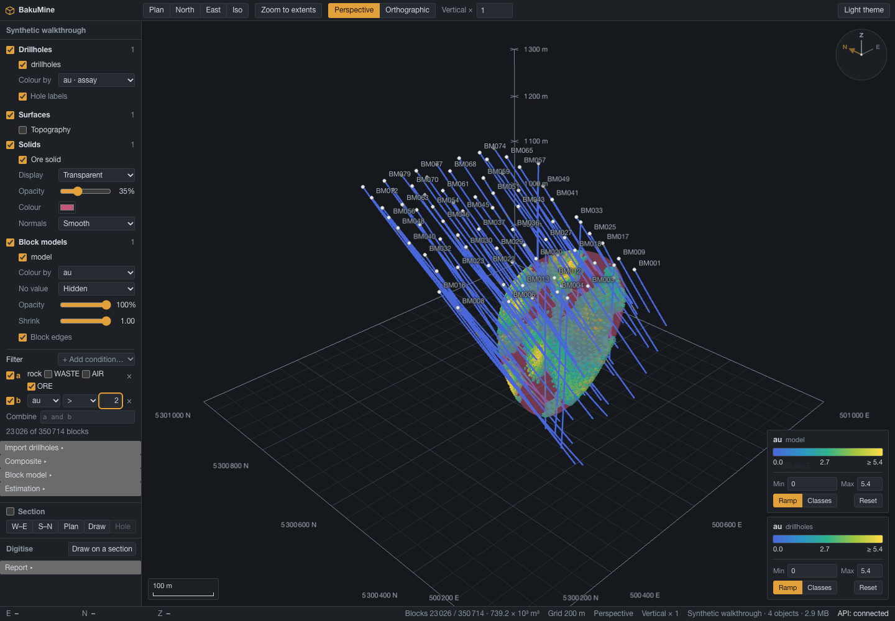
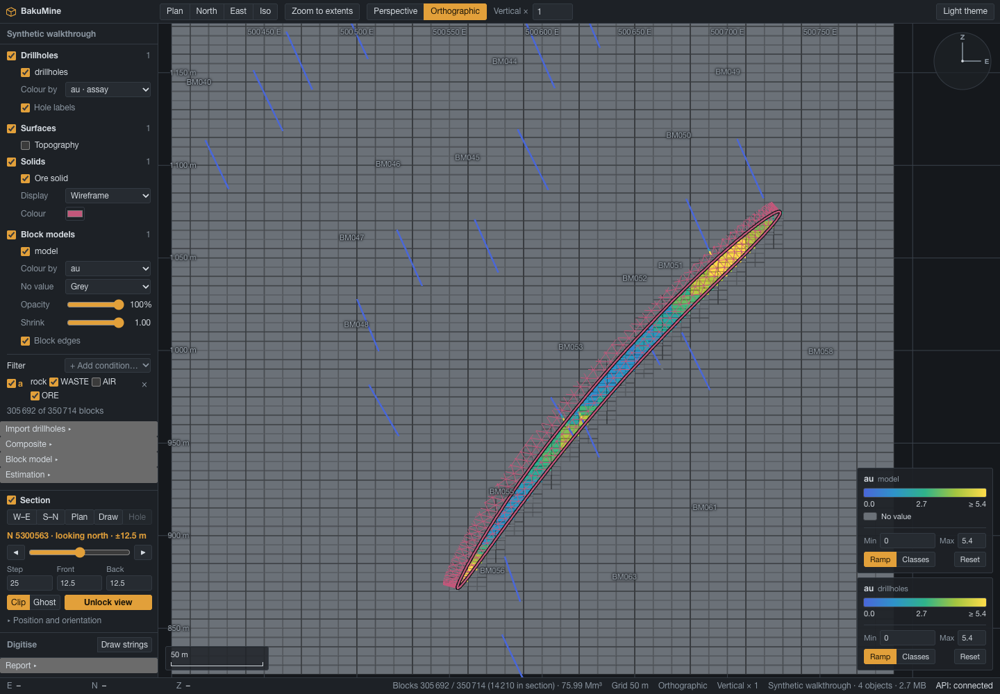

# BakuMine Block Modeller

Drill holes in, validated 3D block model out. BakuMine imports drillhole tables, checks and
desurveys them, composites the samples, builds and codes a sub-blocked block model against
solids and surfaces, estimates grades (nearest neighbour, inverse distance, ordinary / simple
kriging) and reports volume, tonnes and grade. A browser viewer shows the drillholes,
wireframes and blocks in 3D and on sections.

BakuMine is a clean-room implementation written from published literature (see
[research.md](research.md)). It is not affiliated with, endorsed by or derived from
Dassault Systèmes or GEOVIA Surpac. It exchanges data with other packages through text
formats only.



## Features

- **Drillholes**: import collar / survey / interval tables (CSV, XLSX) with column mapping,
  feet to metres, dip conventions, below-detection rules; 18 validation checks; desurvey
  (minimum curvature, balanced tangent, tangent); downhole, bench and domain compositing,
  grade capping. Missing assays stay missing (NaN), never 0.
- **Geometry**: triangle meshes with validation and repair, DTM surfaces, inside/outside
  tests, sections, solids from section strings, implicit solids from drillhole codes.
- **Block model**: regular or rotated grid, octree sub-blocking (up to depth 3) on solid and
  surface contacts, float / integer / category attributes, constraints (solid, DTM, plane,
  attribute expression, combined), calculations with a safe expression language.
- **Estimation**: search ellipsoids with octant and per-hole limits, NN, IDW, OK / SK (point
  or block), nested variogram models, multi-pass plans per domain, dynamic anisotropy,
  experimental and fitted variograms, cross-validation, swath and global checks.
- **Report**: volume, tonnes, grade and metal by attribute, bench and cut-off; CSV out.
- **Viewer** (browser): drillholes coloured by assay or code, solids and surfaces, blocks
  coloured by any attribute, a block filter, section tools (W-E / S-N / plan / drawn line /
  through a hole, stepping, clip or ghost), digitising strings on a section and building a
  solid from them, and sidebar panels that run the whole workflow on a project.
- **CLI**: every step runs from `bakumine <command>`.

## Requirements

- macOS or Linux, `make`, `git`
- [uv](https://docs.astral.sh/uv/) (installs Python 3.12 for the project by itself)
- Node.js 22.12 or newer (20.19+ also runs the viewer; the web tests need 22.12+) with npm

## Install

```sh
git clone <this repository> bakumine
cd bakumine
make install          # uv sync + npm install in web/
```

## Start

```sh
make dev
```

This starts the API on http://127.0.0.1:8000 and the viewer on **http://localhost:5173**
(Vite takes the next free port, 5174 and so on, if 5173 is busy; the terminal shows the URL).
If port 8000 is taken, run `make dev API_PORT=8010`. Ctrl-C stops both.

Without a project, the viewer opens the **synthetic demo deposit** (`data/synthetic/default`):
80 drillholes, topography, the ore solid and the truth block model. Check the API with
`curl http://127.0.0.1:8000/api/v1/scene`.

## Walkthrough A: the synthetic project in the browser

The sidebar panels (Import, Composite, Block model, Estimation, Report) work on a **project
folder**, so first make one with the ore solid and the topography in it (the *Surfaces and
solids* panel can also import both files from the browser, see below):

```sh
uv run bakumine project init ~/bakumine-demo --name "Synthetic walkthrough"
uv run bakumine project add ~/bakumine-demo solid data/synthetic/default/ore_solid.obj --name "Ore solid" --id ore-solid
uv run bakumine project add ~/bakumine-demo dtm data/synthetic/default/topo.obj --name Topography --id topo
BAKUMINE_PROJECT=~/bakumine-demo make dev
```

Open the viewer and work down the sidebar. The numbers below are the true parameters of
the synthetic deposit (from `data/synthetic/default/truth.json`).

1. **Import drillholes**: choose `collar.csv`, `survey.csv`, `assay.csv` and `geology.csv`
   from `data/synthetic/default/`, check the proposed column map, *Import and validate*. The summary shows
   the validation result (0 errors) and the drillholes appear in 3D.
2. **Composite**: table `assay`, mode `domain`, length `2`, domain table `geology`, column
   `rock`, *Composite*.
3. **Block model**: origin `500400, 5300250, 825`, block size `10, 10, 5`, shape
   `39, 52, 84`, sub-block depth `2`, *Create model*. Then code it: attributes `rock` (background
   `WASTE`) and `density` (`t/m3`), and three steps:
   - `rock` = `AIR` where *DTM* `topo` *above* (tick *outside*),
   - `rock` = `ORE` where *solid* `ore-solid` *inside*,
   - `density` = `iif(rock == "ORE", 2.85, 2.7)` where *attribute* `rock != "AIR"`;

   then *Code model*.
4. **Estimation**: method ordinary kriging, grade `au`, domain `ORE` with blocks where
   `rock == "ORE"` and sample column `domain` equal to `ORE`; radii `120, 70, 15`, angles
   `35, -10, 50`, nugget `0.15`, spherical sill `0.85`; three passes (radius factor / min /
   max / max per hole): `0.25 / 6 / 16 / 4`, `0.5 / 3 / 16 / 4`, `1.5 / 1 / 16 / -`.
   *Run estimation* (a few seconds); progress and a summary appear in the panel.

   

5. **Report**: grade `au`, density `density`, group by `rock`, *Run report*; *Export CSV*
   saves it. ORE comes out at about 5.86 Mt at 1.96 g/t (truth: 5.86 Mt, 2.01 g/t).

   

6. **Look at the model**: under *Block models*, colour by `au`; in *Filter* add a
   *Categories* condition and keep `ORE`, then e.g. *Attribute value* `au > 2`. The status
   bar counts the selected blocks and their volume. Hover a block for its values; click it
   for the block panel.

   

7. **Sections**: *Section* > `W-E` (or `S-N`, `Plan`, *Draw* a line, *Hole* through the
   selected hole); step with the arrows or the slider, set the slab width, *Clip* or
   *Ghost*, and *Look at section* for a locked square-on view with real coordinates on the axes.

   

8. **Digitising**: with a section active, *Digitise* > *Draw strings*: click to add points
   (they snap to drillhole crossings and interval boundaries while *Snap* is ticked), close
   the string, *Save strings* (also downloadable as `.str`). Strings on several sections can be built into a solid
   (*Build solid*), which is added to the project and can be used for coding.

The toolbar has standard views (Plan, North, East, Iso), zoom to extents, perspective /
orthographic, vertical exaggeration and a light theme.

## Walkthrough B: the same model from the command line

One script runs the whole chain on the synthetic data and compares the result with the
truth (about 5 s):

```sh
uv run python scripts/gate_synthetic.py          # writes data/synthetic/gate_out/
```

It prints the estimation summary, the report and the gate metrics (ORE volume within 0.05 %
of the truth, metal within 2.5 %, block/truth correlation 0.81). The individual commands it
runs are:

```sh
S=data/synthetic/default; O=data/synthetic/gate_out
uv run bakumine import --collar $S/collar.csv --survey $S/survey.csv --assay $S/assay.csv \
    --geology $S/geology.csv --out $O/db --auto
uv run bakumine validate $O/db
uv run bakumine desurvey $O/db
uv run bakumine composite $O/db --table assay --mode domain --length 2 \
    --domain-table geology --domain-column rock
uv run bakumine blockmodel create $O/model --origin 500400,5300250,825 --size 10,10,5 \
    --shape 39,52,84 --max-depth 1
uv run bakumine blockmodel code $O/model --steps $O/coding.json --geometry-dir $S --merge
uv run bakumine estimate $O/model --composites $O/db/composites_assay.parquet \
    --plan $O/plan.json --geometry-dir $S
uv run bakumine blockmodel report $O/model --where 'rock == "ORE"' --grade au:g/t \
    --density density --out $O/report.csv
```

`coding.json` and `plan.json` are the JSON forms of the coding steps and estimation passes of
walkthrough A; the script writes them into `gate_out/` and they are a good template.
`uv run bakumine --help` lists every command and `uv run bakumine <command> --help` its
options (`blockmodel info | export-csv | import-csv | create | code | report`,
`project init | add | list`, `synth` to generate a new synthetic deposit, ...).

## Working with a project folder

A project folder holds `project.json` and the objects in sub-folders (`database/`,
`composites/`, `models/`, `solids/`, `dtm/`, `strings/`, `constraints/`).

```sh
uv run bakumine project init PATH [--name NAME]
uv run bakumine project add PATH {database,composite,string,dtm,solid,model,constraint} SOURCE [--name N] [--id ID]
uv run bakumine project list PATH
BAKUMINE_PROJECT=PATH make dev      # the viewer and API serve this project
```

For example, to look at the CLI result of walkthrough B in the browser:

```sh
uv run bakumine project init ~/bakumine-cli
uv run bakumine project add ~/bakumine-cli database data/synthetic/gate_out/db
uv run bakumine project add ~/bakumine-cli model data/synthetic/gate_out/model --name "OK model"
uv run bakumine project add ~/bakumine-cli solid data/synthetic/default/ore_solid.obj --name "Ore solid"
BAKUMINE_PROJECT=~/bakumine-cli make dev
```

Without `BAKUMINE_PROJECT` the server shows the read-only demo, and the workflow panels
report that no project is served.

## Surfaces and solids from the data

When there is no topography or wireframe yet, both can be made from the drillholes, from
the command line or in the sidebar (*Surfaces and solids*, *Implicit solid*):

```sh
# topography: collars (+ point tables, strings, breaklines), extended 200 m beyond the data
uv run bakumine surface from-points --database DB --points survey.csv --breaklines crest.str \
    --extend-padding 200 --project PATH --name Topography
# an existing surface or solid file (DXF, OBJ, PLY, Surpac text .dtm with its .str)
uv run bakumine surface import pit.dxf --kind dtm --project PATH
# a solid of the intervals logged ORE; the body dips 70 degrees towards 090
uv run bakumine solid implicit DB --column rock --code ORE --dip 70 --dip-azimuth 90 \
    --ratios 4:3:1 --max-extrapolation 60 --topography PATH/dtm/topography.obj --project PATH
```

`--out FILE` and `--geometry-dir DIR` write the mesh instead of (or as well as) adding it to
a project. The extension adds points on a rectangle (the box of the data plus a padding,
`--extend-rectangle`, or `--extend-model`) at the elevation of the nearest data point, or
at `--extend-z`. An implicit solid needs the orientation of the body: `--dip`,
`--dip-azimuth`, optional `--pitch` and `--ratios` (along strike : down dip : across), or
`--angles bearing,plunge,dip`. `--anisotropy auto` estimates the plane from one point per
intercept and prints what it used; check it, because few or long intercepts do not fix a
plane. The Estimation panel takes the same dip / dip azimuth / pitch input for the search
ellipsoid, and up to three variogram structures each with its own ranges and orientation.

## Real-data example

`scripts/run_babbitt.py` runs the Babbitt Cu-Ni drillholes (399 holes, feet, positive-down
dips; `data/public/babbitt`, MIT-licensed via PyGSLIB, see its `SOURCE.md`) through the CLI:
unit conversion, a grade-based domain, capping, fitted variograms, ordinary kriging in three
passes and validation checks.

```sh
uv run python scripts/run_babbitt.py             # writes data/reference/babbitt_out/
uv run python scripts/run_babbitt.py --no-cv     # skip cross-validation (faster)
```

The script's docstring explains each choice and the numbers it reaches. There is no logged
geology or wireframe in that data set, and the density (2.9 t/m3) is assumed.

## File formats

| In | Out |
|---|---|
| Drillhole tables: CSV, XLSX | Drillhole database and composites: Parquet folder; composites CSV |
| Block model CSV (`blockmodel import-csv`) | Block model: folder of Parquet + JSON (lossless); block CSV (`blockmodel export-csv`) |
| Meshes: OBJ, PLY, DXF (3DFACE / polyface), Surpac-style `.dtm` | Meshes: OBJ, PLY, DXF, `.dtm` |
| Strings: Surpac-style `.str`, DXF polylines | Strings: `.str`, DXF |
| | Report: CSV |

The Surpac-style text layouts (`.str`, `.dtm`, block CSV) are **provisional**: they were
written from documentation and have not yet been checked against files exported by Surpac
(the assumptions are listed in the module docstrings in `bakumine/core/io/`). Binary
Surpac files and `.mdl` models are not read.

Coordinates are `x = east, y = north, z = up`, in metres, float64; Surpac's `Y, X, Z` order is
converted at import and export.

## Testing

```sh
make check         # ruff + pytest + web typecheck + vitest (must be green before a commit)
make e2e           # browser tests with Playwright (once per machine: `cd web && npx playwright install chromium`)
make screenshots   # rebuilds docs/screenshots/ by running walkthrough A in a browser
uv run pytest tests/estimation -k kriging    # a subset
```

Numerical routines are tested against analytic cases and independent libraries (scipy,
trimesh, gstools, PyKrige, wellpathpy), and the whole chain against the synthetic deposit
with known truth.

## Project layout

```
bakumine/core/drillholes   import, validate, desurvey, composite
bakumine/core/geometry     strings, DTM, solids, mesh operations
bakumine/core/blockmodel   definition, sub-blocks, attributes, constraints, storage
bakumine/core/estimation   search, NN, IDW, variograms, kriging, validation
bakumine/core/io           CSV, .str/.dtm, block CSV, DXF, OBJ, PLY
bakumine/core/report       volume / tonnes / grade
bakumine/api               FastAPI app (the viewer's backend)
bakumine/cli.py            the `bakumine` command
web/                       Vite + React + TypeScript + three.js viewer; web/e2e browser tests
scripts/                   gate_synthetic.py, run_babbitt.py, bench_perf.py
data/synthetic/default     synthetic benchmark deposit with known truth
data/public/babbitt        real drillhole data set
tests/                     mirrors the package layout
```

## More

- [research.md](research.md): the theory and formulas behind each step
- [plan.md](plan.md): task list and progress log
- [STATUS.md](STATUS.md): what works, what is verified, known limits

Licence: Apache 2.0 (see [LICENSE](LICENSE)).
